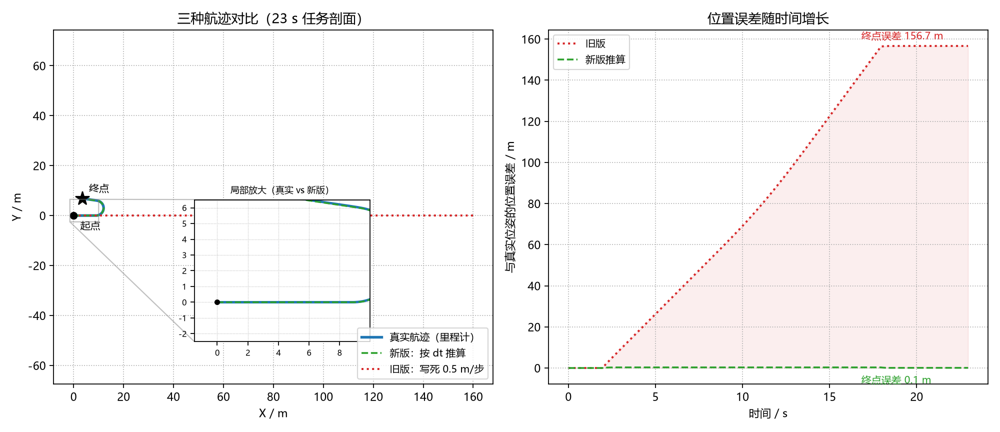

# 无人机航迹推算与飞行状态识别（修复版）

## 作业概述与背景

本模块基于 ROS 2 实现无人机飞行状态识别与航迹记录。本作业对原版实现进行了
**正确性修复与重构**：原版把速度指令当成位姿来源、用写死的"每步 0.5 米"积分，
并且状态判定分支互斥，导致航迹与识别结果在常见飞行场景下系统性失真。

## 原版缺陷与量化验证

以下结果由 `tools/repro_old_bugs.py` 复现（该脚本原文照抄旧版分支逻辑）：

| # | 缺陷 | 后果 | 量化证据 |
|---|------|------|----------|
| 1 | 每步位移写死 `0.5 m`，与线速度、回调周期无关 | 航迹长度只取决于回调次数 | 1 m/s × 10 s：1 Hz 时航迹缩水 50%；20 Hz 时膨胀 900% |
| 2 | `if linear.x > 0` 分支抢先吞掉转向分量 | 弧线飞行被画成直线 | v=1、w=1 转 6 步：航向变化 0 rad（应为 6 rad） |
| 3 | 只判 `angular.z > 0` | 右转被识别为悬停 | w=-1 转 5 步：航向变化 0 rad |
| 4 | 用 `cmd_vel`（期望值）代替真实位姿 | 航迹不反映实际飞行 | 指令积分 10 m vs 实际 7.5 m（偏差 +33%） |

## 修复方案

核心逻辑抽到 `trajectory_core.py`（纯标准库，可脱离 ROS 单元测试）：

1. **状态判定两轴独立组合**：线速度×角速度独立判定，共 8 种状态
   （悬停 / 直线巡航 / 原地左右转 / 左右弧线 / 后退左右转）；
2. **按物理规律积分**：直线 `v·dt`；圆弧用独轮车模型闭式积分
   （`R = v/w`），转满一圈精确回到起点；
3. **位姿优先来自里程计**：订阅 `nav_msgs/Odometry` 的实测位姿；
   仅在里程计超时 1 s 后降级为指令推算，并在日志中标记
   `source=dead_reckoning`；
4. **时间戳可信性检查**：`dt` 为 0/负数/非有限值时丢弃并计数，
   超过 `dt_max`（默认 1 s，覆盖 1 Hz 慢速发布）时截断，防卡顿突跳；
5. **航迹落盘**：CSV（`t,x,y,z,yaw,v,w,state`），退出时输出架次统计
   （里程、位移、直线度、悬停占比、各状态时长）；
6. **绘图降频**（默认 5 Hz）且可 `--no-plot` 关闭，不再在回调里高频阻塞。

## 核心代码文件清单

```text
src/drone_trajectory_logger/
├── drone_trajectory_logger/
│   ├── __init__.py
│   ├── main.py                     # 仿真数据源（指令 + 一阶滞后里程计）
│   ├── trajectory_analyzer.py      # 航迹识别/记录节点（重写）
│   └── trajectory_core.py          # 纯逻辑核心（新增）
├── test/
│   └── test_trajectory_core.py     # 28 项单元测试（新增）
├── tools/
│   ├── repro_old_bugs.py           # 旧版缺陷复现脚本（新增）
│   ├── offline_demo.py             # 三航迹对比图生成（新增）
│   └── run_ros_demo.py             # ROS 2 双节点联调脚本（新增）
├── launch/
│   └── main.launch.py
├── package.xml
├── setup.py
└── README.md
```

## 运行步骤

方式一（Ubuntu / colcon）：

```
mkdir -p ~/ros2_ws/src
cp -r ~/OpenHUTB/ros2/src/drone_trajectory_logger ~/ros2_ws/src/
cd ~/ros2_ws
colcon build --packages-select drone_trajectory_logger
source install/setup.bash
ros2 launch drone_trajectory_logger main.launch.py
```

方式二（Windows / RoboStack conda，无需编译，直接以模块方式运行）：

```
cd src/drone_trajectory_logger
python -m drone_trajectory_logger.main --once            # 仿真数据源
python -m drone_trajectory_logger.trajectory_analyzer --no-plot --exit-after 24.5
```

方式三（无 ROS 环境，纯离线对比）：

```
python src/drone_trajectory_logger/tools/offline_demo.py
python src/drone_trajectory_logger/tools/repro_old_bugs.py
```

## 任务剖面与验证结果

任务剖面（20 Hz）：悬停 2 s → 巡航 6 s（1.5 m/s）→ 左弧线 6 s（1.5 m/s,
0.5 rad/s，半径 3 m）→ 巡航 4 s → 原地右转 3 s → 悬停 2 s。

### 1. 单元测试 28/28 通过

```
test/test_trajectory_core.py ............................    [100%]
28 passed in 0.06s
```

覆盖：8 种状态判定（含旧版两个缺陷的回归用例）、直线/圆弧积分已知答案、
转满一圈闭合、回调频率无关性（1 Hz vs 20 Hz 同航迹）、dt 异常处理、
四元数取航向、CSV 往返、抽稀保端点。

### 2. 离线对比（tools/offline_demo.py）

| 指标 | 真实(里程计) | 新版推算 | 旧版推算 |
|---|---|---|---|
| 航迹里程 | 24.00 m | 24.00 m | **160.00 m** |
| 起点-终点位移 | 7.73 m | 7.66 m | **160.00 m** |
| 直线度 | 0.322 | 0.319 | **1.000** |
| 终点位置误差 | — | **0.07 m** | **156.66 m** |

旧版在同一剖面只识别出 `hover / cruise` 两种状态；新版识别出
`cruise / arc_left / turn_right / hover / arc_right` 五种。



### 3. ROS 2 双节点闭环联调（Windows 11 + RoboStack ROS 2 Humble）

`tools/run_ros_demo.py` 同时拉起发布端与分析端，运行 23 s 任务剖面：

```
t= 2.03s 状态切换 -> cruise（直线巡航）
t= 8.03s 状态切换 -> arc_left（左弧线飞行）
t=15.38s 状态切换 -> cruise（直线巡航）
t=18.03s 状态切换 -> arc_right（右弧线飞行）
t=19.62s 状态切换 -> turn_right（原地右转）
t=22.52s 状态切换 -> hover（悬停）

架次统计（数据来源：里程计）
  记录点数      : 460（里程计 460 帧 / 推算 0 帧）
  飞行时长      : 22.91 s     航迹里程 : 24.49 m
  起点-终点位移 : 7.72 m      直线度   : 0.315
  悬停占比      : 10.4%
```

完整日志见 `ros_analyzer_log.txt` / `ros_pub_log.txt`，
原始航迹见 `ros_demo_trajectory.csv`（460 帧）。

## 运行环境

* Windows 11 / Python 3.12（单元测试与离线演示）
* RoboStack conda 发行版 ROS 2 Humble（双节点联调）
* 依赖：rclpy, geometry_msgs, nav_msgs, matplotlib

## 作业信息

* 姓名：黄家欣
* 学号：2535030010

## 声明

本作业使用大模型辅助编写代码与文档。所有测试与运行结果均为真实执行产出。
