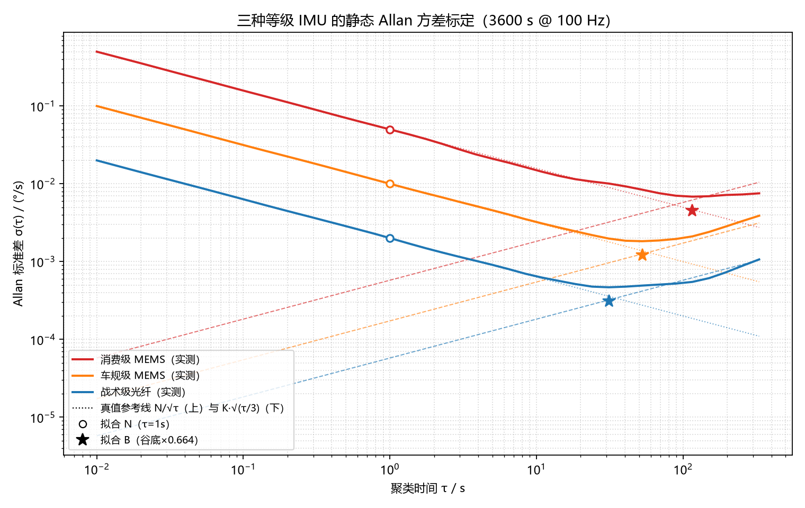

# IMU 零偏与噪声标定（Allan 方差）

## 作业概述与背景

惯性导航的精度上限由 IMU 的噪声特性决定。降低成本、上量交付前，必须回答三个问题：

1. 这个陀螺仪的白噪声有多大？（决定导航解算短期发散速度）
2. 零偏能标到多准、稳定到什么程度？（决定对准时长与纯惯性保持时间）
3. 零偏会不会随时间慢漂移？（决定是否需要 GPS/视觉辅助在线估计）

本模块实现 IMU 静态标定的标准方法——**Allan 方差法**（IEEE Std 952-1997），
从一段静止采集数据中同时估出三个噪声系数：

| 系数 | 含义 | Allan 曲线特征 | 对导航的影响 |
|---|---|---|---|
| N（角度随机游走） | 白噪声强度，°/√s | 左段斜率 −1/2 | 纯惯性姿态误差随 √t 发散 |
| B（零偏不稳定性） | 零偏慢波动下限，°/s | 谷底 ×0.664 | 决定可达到的长时间精度极限 |
| K（速率随机游走） | 零偏漂移强度，°/s/√s | 右段斜率 +1/2 | 决定多久的标定会过期 |

## 算法原理

### 数据模型

静态放置时陀螺仪输出建模为：

$$\omega_{meas}(t) = b + n_{white}(t) + w(t)$$

其中 $n_{white}$ 为白噪声（功率谱密度 $N^2$），$w$ 为速率随机游走（功率谱密度 $K^2$），$b$ 为零偏。

### Allan 方差

把数据按聚类长度 $m$（对应聚类时间 $\tau = m/f_s$）分块平均，得到相位序列 $\theta$，则：

$$\sigma^2(\tau) = \frac{1}{2\tau^2}\left\langle \left(\theta_{i+2m} - 2\theta_{i+m} + \theta_i\right)^2\right\rangle$$

三种噪声在双对数 $\sigma(\tau)$ 曲线上分别表现为 $\tau^{-1/2}$、谷底、$\tau^{+1/2}$，因此一条曲线可以同时解出三个系数。

### 参数拟合

- **N**：左段（$\tau \le 1$ s、谷底左侧）$\sigma = N/\sqrt{\tau}$，即 $N = \overline{\sigma\sqrt{\tau}}$；
- **B**：曲线最低点，$B = 0.664\,\sigma_{min}$（IEEE 952 惯例）；
- **K**：右侧（$\tau \ge 3\tau_{min}$，带逐级回退）$\sigma = K\sqrt{\tau/3}$，即 $K = \overline{\sigma\sqrt{3/\tau}}$。

### 实现细节

- 聚类长度用 **1.3 倍几何步长**而非纯 2 的幂：真实谷底 $\tau^* = N\sqrt{3}/K$ 常常落不到 2 的幂网格上，导致最低点滑到曲线末端、K 估不出；
- $\tau_{max} = T/9$：每段至少 9 个不重叠聚类，估计才有统计意义；
- 零偏估计丢弃前 30 s（滤波收敛），返回均值与标准差。

## 文件清单

```text
src/air/imu_allan_calibration/
├── imu_core.py                 # 纯标准库核心：仿真器 + Allan 方差 + 拟合 + 标定
├── test/test_imu_core.py       # 15 项单元测试
├── tools/make_demo.py          # 三等级 IMU 对比演示（图 + JSON 报告）
├── calibration_report.json     # 标定报告（演示产出）
└── test_report.txt             # 测试日志
```

## 运行步骤

```bash
# 单元测试
cd src/air/imu_allan_calibration
python -m pytest test/test_imu_core.py -v

# 演示（三种等级 IMU 对比，输出图与 JSON 报告）
python src/air/imu_allan_calibration/tools/make_demo.py
```

对真实 IMU 数据标定时，把静态采集的一列角速率（同单位）传入：

```python
import imu_core as imu
report = imu.calibrate(gyro_z_list, fs=100.0, trim_s=30.0)
print(report['bias'], report['N'], report['B'], report['K'])
```

## 验证结果

### 单元测试 15/15 通过

```
test/test_imu_core.py ...............    [100%]
15 passed in 2.65s
```

覆盖：已知参数恢复（纯白噪声 N 误差 <15%、纯随机游走 K 误差 <25%）、
恒定零偏不抬升 Allan 曲线（差分消偏）、τ 网格单调性、B 定义一致性、
单位无关性、异常输入处理。

### 三等级 IMU 标定演示（3600 s @ 100 Hz，357000 样本/台）

| 指标 | 消费级 MEMS | 车规级 MEMS | 战术级光纤 |
|---|---|---|---|
| 真值 N (°/√s) | 0.0500 | 0.0100 | 0.0020 |
| 拟合 N（误差） | 0.0499（**0.2%**） | 0.0100（**0.2%**） | 0.0020（**0.3%**） |
| 真值 K (°/s/√s) | 0.0010 | 0.0003 | 0.0001 |
| 拟合 K（误差） | 0.00076（24%） | 0.00036（20%） | 0.00009（**7%**） |
| 谷底 τ | 115.5 s | 52.6 s | 31.1 s |
| 静态零偏估计 | 0.2204（10.2%） | 0.0610（22.0%） | 0.0174（74.1%） |



### 结果解读（本作业的关键观察）

1. **N 拟合几乎精确**（<0.3%）：白噪声有大量独立聚类，统计收敛快；
2. **K 误差 7%~24%**：随机游走的单次实现方差大，1 小时数据只覆盖
   谷底右侧少数几个点——工程上要精确标 K 需要更长的采集（数小时）；
3. **"零偏估计"偏差随传感器等级升高反而变大**（10%→74%）：这不是算法
   缺陷——静态均值里混入了速率随机游走造成的慢漂移，而战术级 IMU 的
   真实零偏太小（0.01 °/s），漂移量相对显著。**单次静态标定无法分离
   零偏与慢漂移，这正是 B 系数存在、也是高等级 IMU 需要数小时对准的
   原因**，也是低成本 MEMS 必须依赖 GPS/视觉做零偏在线估计的动机。

完整 JSON 报告见 `src/air/imu_allan_calibration/calibration_report.json`。

## 运行环境

- Windows 11 / Python 3.12，纯标准库（matplotlib 仅绘图需要）
- 单位无关：rad/s 与 °/s 均可，报告单位与输入一致

## 作业信息

- 姓名：黄家欣
- 学号：2535030010

## 声明

本作业使用大模型辅助编写代码与文档。所有测试与运行结果均为真实执行产出。
